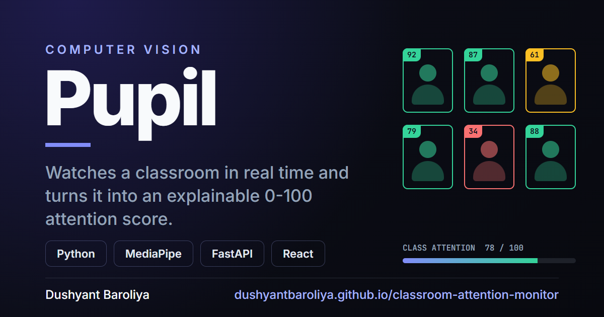

```text
$ dushyantfetch
           ,oOKXWWWWXKOo:                dushyant@bengaluru
        o0NNWNXKOOOOKXNWNNKx,            ------------------
     :0NNKx:            :xKNN0:          Host: NMIT Bengaluru, class of 2027
    kNNk,                  ,kNN0,        OS: Mechanical Engineering + AI minor
  :XNK,                      ,KNX:       Focus: AI · quant finance · distributed systems
 ,NNk                          kNN:      Languages: Rust, TypeScript, Python, Dart, C
 KMO    .NNXXX0x:   XN000Oo     OMX      Shipped: Ledger, Signal, Swarm, Pupil
cMM,    'MMkxx0NMk .MMdlkMMl    ,MMc     Building: LAZR (private, on-device AI)
dMX     'MM;   dMM;.MMKOKN0      XMx     Frameworks: React, Next.js, Flutter, FastAPI
dMX     'MM;   dMM,.MMkxkKMk     XMx     Motto: build small, guarantee much, ship quietly
cMM,    'MMkxxKNWo .MMdloXMO    ,MMc
 KMO    .NNXX0Oo    XN0000o     OMX      contacts
 :NNk                          kNN:      --------
  :XNK,                      ,0NX:       Portfolio: dushyant-portfolio-pi.vercel.app
   ,0NNk,                  ,kNN0,        LinkedIn: in/dushyant-baroliya
     :0NNKx,            ,xKNN0:          Email: dushyantbaroliya2@gmail.com
       ,xKNNWNKOOxxOOKNWNNKx,            GitHub: github.com/dushyantbaroliya
           :oOXXWWWWXXOx:
```

<br/>

### `~/` Shipped

Every project below runs live in your browser. Click a picture to play with it.

<table>
<tr>
  <td width="50%" valign="top">
    <a href="https://dushyantbaroliya.github.io/ledger/"></a>
    <br/>
    <b>⬦ Ledger</b> &nbsp;<sub><code>quant finance</code></sub>
    <br/>
    A stock-exchange matching engine written in Rust, compiled to WebAssembly so the whole market runs in your tab. Deterministic, with a live depth ladder and tape.
    <br/>
    <a href="https://dushyantbaroliya.github.io/ledger/"><b>Live demo</b></a> &nbsp;·&nbsp; <a href="https://github.com/dushyantbaroliya/ledger">Source</a>
  </td>
  <td width="50%" valign="top">
    <a href="https://dushyantbaroliya.github.io/signal/"></a>
    <br/>
    <b>⬦ Signal</b> &nbsp;<sub><code>interactive essay</code></sub>
    <br/>
    How options think, from the payoff hockey stick to the Greeks and the volatility smile. Every figure is hand-drawn in canvas and computed live, including a 3D surface with no WebGL.
    <br/>
    <a href="https://dushyantbaroliya.github.io/signal/"><b>Live demo</b></a> &nbsp;·&nbsp; <a href="https://github.com/dushyantbaroliya/signal">Source</a>
  </td>
</tr>
<tr>
  <td width="50%" valign="top">
    <a href="https://dushyantbaroliya.github.io/swarm/"></a>
    <br/>
    <b>⬦ Swarm</b> &nbsp;<sub><code>distributed systems</code></sub>
    <br/>
    A drawing board you share with friends, no server in the middle. Break the network on purpose and every board still ends up matching. Hand-written CRDT, checked over 10,000 randomized runs.
    <br/>
    <a href="https://dushyantbaroliya.github.io/swarm/"><b>Live demo</b></a> &nbsp;·&nbsp; <a href="https://github.com/dushyantbaroliya/swarm">Source</a>
  </td>
  <td width="50%" valign="top">
    <a href="https://dushyantbaroliya.github.io/classroom-attention-monitor/"></a>
    <br/>
    <b>⬦ Pupil</b> &nbsp;<sub><code>computer vision</code></sub>
    <br/>
    Real-time classroom engagement: head pose, blinks, gaze, phones and raised hands fused into an explainable 0-100 attention score. No face recognition, by design.
    <br/>
    <a href="https://dushyantbaroliya.github.io/classroom-attention-monitor/"><b>Live demo</b></a> &nbsp;·&nbsp; <a href="https://github.com/dushyantbaroliya/classroom-attention-monitor">Source</a>
  </td>
</tr>
</table>

<br/>

### `~/` Currently building: LAZR

> A local-first personal intelligence app. It indexes your files, notes and screenshots and answers questions about *your* world, with citations, entirely on-device. No accounts, no telemetry. Airplane mode is a test gate, not a marketing line.

<table>
<tr>
<td><b>Architecture</b></td>
<td>Flutter · Clean Architecture · Riverpod · GoRouter</td>
</tr>
<tr>
<td><b>Retrieval</b></td>
<td>SQLite FTS5 · local vector index · grounded-only answers with citations</td>
</tr>
<tr>
<td><b>Intelligence</b></td>
<td>On-device LLM + embedding runtimes · zero data egress</td>
</tr>
<tr>
<td><b>Status</b></td>
<td><code>in progress</code> · private until it is ready</td>
</tr>
</table>

<br/>

### `~/` Toolchain

<p>
  
  
  
  
  
  
</p>
<p>
  
  
  
  
  
</p>
<p>
  
  
  
  
  
  
</p>

<br/>

### `~/` Also here

- **[dushyant-baroliya-portfolio](https://github.com/dushyantbaroliya/dushyant-baroliya-portfolio)**: my site. Next.js 15, Tailwind v4, Framer Motion, Lenis smooth scroll.
- **[iot-boiler-monitoring-system](https://github.com/dushyantbaroliya/iot-boiler-monitoring-system)**: real-time boiler telemetry on an ESP32, streamed to ThingSpeak with alert thresholds.

<br/>

### `~/` Activity

<div align="center">
  
</div>


<br/>

### `~/` Reach me

Open to internships, research collaborations, and hard systems problems worth chasing. I read every thoughtful message.

<div align="center">
  <a href="https://dushyant-portfolio-pi.vercel.app"><b>Portfolio</b></a> &nbsp;·&nbsp;
  <a href="https://www.linkedin.com/in/dushyant-baroliya/"><b>LinkedIn</b></a> &nbsp;·&nbsp;
  <a href="mailto:dushyantbaroliya2@gmail.com"><b>Email</b></a>
</div>

<br/>

<div align="center">
  <sub><code>build small · guarantee much · ship quietly</code></sub>
</div>
